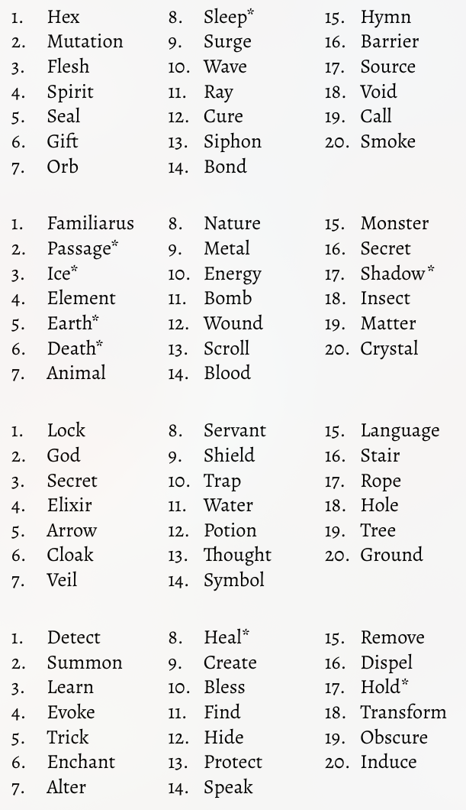

# The Wise

| Level | XP      | HD  | AV  | SV  | Slots | Groups | Raises |
| :---: | ------- | :-: | :-: | :-: | :---: | :----: | :----: |
| 1     | 0       | 1+1 | 10  | 6   | 1     | 2      | —      |
| 2     | 2,350   | 2   | 11  | 7   | 1     | 2      | 1      |
| 3     | 4,700   | 2+1 | 11  | 8   | 2     | 2      | 1      |
| 4     | 9,400   | 3   | 11  | 9   | 2     | 3      | 2      |
| 5     | 18,800  | 4   | 12  | 10  | 3     | 3      | 2      |
| 6     | 37,600  | 4+1 | 12  | 11  | 3     | 3      | 3      |
| 7     | 75,200  | 5   | 12  | 12  | 4     | 4      | 3      |
| 8     | 150,400 | 6   | 13  | 13  | 4     | 4      | 4      |
| 9     | 300,800 | 6+1 | 13  | 14  | 5     | 4      | 4      |
| 10    | 601,600 | 7   | 13  | 15  | 5     | 5      | 5      |
{: .compact-table }

Wise characters perform **miracles** through arcane negotiations with forces in their environment. They may for example be cultists, chemists, meta-mathematicians, exorcists, druids, bards, runecarvers or wizards. When they gain a slot, they permanently tie two miracles to it—one active (in the slot), and one inactive. Switching takes a day of preparation. The level 1 slot gets an extra inactive miracle for a willpower of 13+, two for 16+.

Each miracle is given a descriptive or evocative **wording**, as in “Telekinesis” or “Patrok, Demon of Passage!” The wording, the character vocation and the desired effect are used to **triangulate a cost** in HP for dealing with the supernatural: the player says what the miracle should do and the Referee suggests the cost. The player may lower it with drawbacks and ingredients. Costs increase the further they are from the wording, the vocation and what can be achieved without magick. You can deliberately pick precise wordings for low costs or vague wordings for versatility.

There are cost guidelines based on **magnitudes** and a reference table of traditional effect–level correlations (p. 38). But costs vary a bit with time and place. The Wise may save once per day and spend 10 minutes to detect and use a local energy concentration, making a single effect of a certain type one magnitude cheaper. Check the save quality against the Energy Concentrations table (also p. 38).

The Wise can’t attempt miracles with an *initial* maximum cost above their current HP, and if the cost is set or rolled above their level, they must save or have it doubled (which can be lethal). Crafting potions, bombs, scrolls etc. works just like any other miracle, but the first charge, dose or disposable item costs double. Permanent magick lowers HP until you re-roll your HD for a new score at the next level. It also requires a steady mind. At the Referee’s discretion, it can’t be attempted on the verge of leveling.

Healing cannot be given permanence or infinite charges, as it is subject to *magick interference* (p. 64). This phenomenon also causes the Wise to supernaturally recuperate from any HP loss at twice the natural rate, but that is the **only** way they heal (they still need treatment, potions etc. for other things than direct HP recovery).

Anyone can use scrolls (p. 65), but the Wise can slot effects with successful trained intelligence rolls. Their level must exceed the HP cost, and the magick glyphs must be ingrained (over 10 years old). The process spends the scroll and ruins any previous wording in the slot, but lets the Wise reproduce the scroll’s static effect once per day at zero HP cost. The slotted effect counts as a miracle and, as such, can be switched into and out of the slot it is tied to.

The level 3 slot *may* hold a magick item—a blackstaff, a talking sword, etc.—instead of miracles. This extends the character’s HP by an amount equal to her level. When chosen, any previous wordings tied to the slot are ruined. The slot can only hold a new item if the previous one breaks, which lowers both maximum and current HP.

The Wise get −2 AV with non-slotted two-handed weapons, +2 SV against magick and mind influencing abilities, and +2 to HP costs (*before* any doubling) when using shields or armor heavier than leather.

## Magick Cost Guidelines

| HP  | Magnitudes                                                                                                                                                                                                                                             |
| :-: | ------------------------------------------------------------------------------------------------------------------------------------------------------------------------------------------------------------------------------------------------------ |
| 0   | **Zero,** trivial effect, slotted scroll or simple effect boosted by a limiting condition.                                                                                                                                                             |
| 1   | **Simple,** can be achieved without magick. Example: minor harming or healing, illumination, unlocking, reading a foreign language.                                                                                                                    |
| 2   | **Standard,** just beyond the possible. Example: generating a protective force field, breathing water, light telekinesis, invisibility.                                                                                                                |
| d6  | **Major,** a major breach of natural law. Example: teleporting, animating skeletons, locating lost things/beings, dispelling, removing an injury.                                                                                                      |
| 2d6 | **Powerful,** use of raw power. Example: resurrection, changing the weather, stopping time, petrification, cloning.                                                                                                                                    |
| +   | **Costly.** Peripheral to vocation or wording. Extra duration, range, effect area, victims, damage. No save. Craft item (Cost × 2). Adding another charge (Cost × 1). Crafting a permanent magick item (Cost × 2 permanent HP). Expensive magick type. |
| -   | **Cheaper.** Very close to vocation and/or wording. Rare/costly ingredients. Bad side effects for the Wise. Wise save (fail negates). Boosting but addictive drugs. Cheap magick type. Extra casting time. Time or place requirements.                 |
{: .compact-table }

## Energy Concentrations

| Quality | Energy for...             |
| :-----: | ------------------------- |
| 1       | Summoning                 |
| 2       | Elemental control         |
| 3       | Necromancy                |
| 4       | Protection and banishment |
| 5       | Illusions                 |
| 6       | Information               |
| 7       | Material alterations      |
| 8       | Mind influence            |
| 9+      | Player choice             |
{: .compact-table }

## Traditional Magick Effects

| Level | Traditional Magick Effects                                                                                                                                                                                                           |
| :---: | ------------------------------------------------------------------------------------------------------------------------------------------------------------------------------------------------------------------------------------ |
| 1     | Detection of forces. Shielding from influence. Minor influencing, harming or healing. Minor illusions and light effects. Reading (magick) languages. Food and drink manipulation. Putting someone to sleep.                          |
| 3     | Blessing or cursing. Sensing the directions of thoughts or hidden things. Minor telekinetic effects. Manipulating locks. Obstructing movement. Communicating with animals. Invisibility.                                             |
| 5     | Curing and infecting. Substantial light effects and elemental attacks. Missile protection. Breathing water. Removing curses and dispelling magick.                                                                                   |
| 7     | Major influencing, harming, healing and illusions. Creating portals. Communicating with and manipulating plants. Transforming yourself into another shape. Material alterations. Mental visual scouting.                             |
| 9     | Animating corpses. Summoning or communicating with eldritch entities and swarms. Creating food and drink. Possession and mind or body control. Major telekinesis and teleportation. Creating or passing through walls. Resurrection. |
| 10+   | Instant killing and destruction. Summoning of powerful undead. Magick landscaping. Self-projection. Reincarnation. Transforming others. Depetrifying victims. Controlling weather.                                                   |
{: .compact-table }

## Creating Miracle Wordings

Writing miracle wordings is a lot of fun but can seem hard the first times you try. Getting help from your co-players and the Referee usually does the trick, but if not, here are five steps that you can follow:

1. Check the Energy Concentrations table and pick one concentration to decide what the miracle is mainly about.
2. Decide if your wording is to be broad and costly but often useful (like “Flames”), or if it is to be specific and cheaper (like “Summon Dire Beast”).
3. Your wording can be the name and title of a summoned creature, as in “Jor, the Knower.” It can be a description of its main use (“Know Item”), or a flamboyant expression named after your character (“Saffron’s Magnificent Divination Ritual”). Another option is to choose the name of an item (“Pendulum of Answers”) or body part (“All-Seeing Eye”), or a corny rhyme or exclamation, as in “Rise, Sage Ghost, Thou Who Knowest More Than Most!”. Finally, you may consider naming it after a specific ingredient or target, as in “Incensical Revelation” or “Heart of the Matter”.
4. Use the oracle on the next page, perhaps in combination with an idea from the Traditional Magick Effects table, if you have a hard time coming up with good words.
5. Once you get something decent, eyeball the wording for a moment, forgetting the previous steps. Is there some change you can make in order to make it feel “just right?”
The Referee is encouraged to allow for minor adjustments of a wording that you choose until the character reaches the next level. This makes the initial choice easier and often a bit faster. But after that, you are stuck with your wording at least until after level 10 (p. 78)[^1].

## Miracle Wording Oracle

The below oracle can be used in part or in full, as you choose. Roll and collect four words and then use the ones you want either as inspiration, an indication of miracle purpose or directly as components in the wording. Words with asterisks have useful opposites.

[^1]: This may sound harsh, but the point of miracles isn’t that your character should be able to do anything she likes. Your character has contours and an identity, and each miracle wording is a part or an extension of who she is. From a game point of view, it is also important that the possibilities of the Wise are limited through the “triangulation” of wording, vocation and effect, so that it becomes a challenge to solve in-game problems with magick. Thus, the only way you can get rid of a wording is by replacing it with something else, i.e. a scroll or an item. The Deft have a similar situation with their attunements.