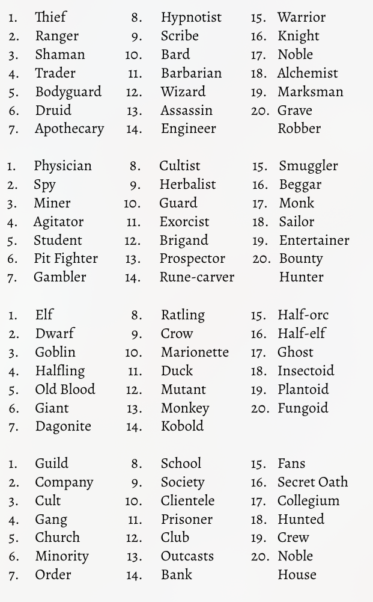

# Groups

Though you do not have to choose right away, each character belongs to at least two groups and will eventually belong to more. Groups are broad definitions of traits, skills, contacts and information that the character possesses. Having a relevant group when attempting tasks that require training, means that you don’t get the same penalties that characters without such a group do.

Each group is written next to an attribute on the character sheet. This means that the group has an even greater weight (you get a positive double roll) when making task rolls using that specific attribute—again if the group has any relevance for the roll. As deft characters get this advantage for all task rolls relative to their vocation group, they do not mark it next to any attribute.

An attribute can have two groups. At every new level, one group may be moved to another attribute.

For each attribute with a score of 5 or less, the character gets one extra affiliation group (see below). For each attribute that is raised above 5, one affiliation group is lost.

In the game world, a character may side with or be in many groups. But she will not belong to them in a game mechanical sense until they are written next to attributes.

## Species

The first type of group is the character’s species. It must normally be chosen at character creation and is defined by physical and broad cultural traits. Species groups are relative to the norm of the game world—if you don’t have a species group, it means that the character is the most common species, usually human. Common fantasy species groups are dwarves, elves, halflings and goblins. Choosing one of those would mean that the character has some physical and cultural traits of that species. It does not mean that the species as a whole is culturally the same. Further group choices can delve deeper into cultural and sub-cultural variations.

Species groups are special. You note them after two attributes, but they can also be used negatively at the Referee’s discretion, as in “dwarves aren’t built to swim fast—make a double negative roll.” If only one of the character’s parents was another species than the norm, mark the species group next to a single attribute.

## Vocations

The second type is the character’s vocation. This can be wizard, barbarian or something similarly adventurous. But it can just as well be plumber or swine herder—literature is full of people with ordinary backgrounds becoming heroes. 

Often, a player will want to choose a vocation in line with the character’s class, but it isn’t necessary. Creating a deft wizard would effectively give you a character whose own magick is petty (it does the nigh impossible), but who is knowledgeable about magick in theory and good at reading spells from books and scrolls. Conversely, a wise knight would be physically weaker than her peers, but still a good tactician with magick to back her up in battle. 

Vocations aren’t mere occupations. A character can only have one vocation but may supplant or develop it as part of her career, if there is an in-game opportunity.

## Affiliations

The third type is the character’s affiliations. Such groups can be guilds, schools, tribes, companies, secret societies, cults or some other social structure. They may provide friends, knowledge, languages, equipment, refuge and aid, and, in rare cases, even specific skills (as in “the Black Hats jealously guard the secret of weird explosives”). Affiliations may also yield xp bonuses (p. 47). 

These things won’t happen unless the affiliation gets something in return, however. It can be donations, but more often services. The Referee is in her right to have an affiliation make demands on the character, proportional to level. For example, a thieves’ guild might demand assistance on a particular job, or part of the character’s loot share from some expedition. The Refere can have the affiliation act on failure to comply. 

Affiliation groups are also likely to give the character enemies. This is the Referee’s domain, supported by the rules for mind maps, events, reactions and reputation (see pp. 104 f., 112). 

In certain campaigns, affiliation groups such as Good, Evil, Lawful etc. designate moral attunement to gods and other powers. Characters without such groups are simply ambiguous and complex in their morals. 

Affiliation groups can be exchanged but must always be plausible in the game world.

## Group Generator

Choose, roll or get inspiration from the below lists. The Referee may add or remove entries to fit the game world. The playable species list tends to be very limited in most settings.

