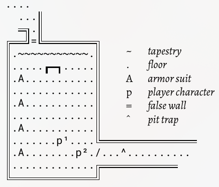

# Examples of Play

Reading examples of play or watching an ongoing game is often a quick way into a new system. Take a look at these examples now to get a feel for how the game plays, then come back to them later, as needed. The rules used are all described in the following chapters. 

## An Exorcist Performs a Miracle

**Referee:** When you step into that corridor, you hear a moaning sound, and as you look up, a green light is spreading from the end of the corridor. You hear scraping sounds too.  
**Player (of a Wise Exorcist):** I hold my holy symbol firmly in one hand and my short sword in the other, but I don’t back down.  
**Referee:** Three creatures emerge from the shadows. Two of them are obviously zombies—you’ve seen that kind before. The third, however, doesn’t have the same slowness about her. Her clothes are in rags, sure, but her skin has a greenish hue and her eyes shine with undead power.  
**Player:** Ouch. Well, this is it. I’m gonna use my miracle “Banish undead” on them.  **Referee:** That sounds like a solid miracle for an exorcist here. What do you want it to do? 
**Player:** I want my miracle to destroy them, you know, like turn them to dust or something.  
**Referee:** Okay, but pulverizing monsters is considered to be major magick. I will let you destroy the zombies if you insist, but you’ll have to pay d6 HP and likely pass a save to avoid doubling the outcome. Since you’re only level two, that’s not a great idea. Even if you succeed, you would only have a few harm points left and the third undead would still be free to act.  
**Player:** What if I just scare the zombies off? Would that work better?  
**Referee:** That sounds more sensible, and it is aligned with both wording and vocation. If you use some holy water and they get to save to avoid it, it’s a single harm point. Okay?  
**Player:** Sure! I sprinkle some holy water, brandish my symbol and shout: “In the name of the Bleeder, return to your evil shadows!”  
**Referee:** \[Rolls zombie saves.\] Their moans take on a different pitch, and they shy away from the power in your words. Only the third creature continues to approach. She seems to be grinning.  
**Player:** Oh crap. Well, I’m gonna charge her!  
**Referee:** You’re about fifteen feet away, so that’s fine. Roll initiative!  

## Being Attuned to Your Bow

**Referee:** I’m sorry but you are too late. As you jump the last of the tower stairs and run to the window, you can see your friend already dangling in the hangman’s noose. She will be dead in moments!  
**Player:** Nooo! I take my bow and nock my last arrow. I am attuned to the bow, so I am going to use my Deft ability. I want to shoot the hangman and cut the cord.  
**Referee:** The distance alone makes hitting anything very hard. But the crucial point here is that the hangman and the rope aren’t aligned for a shot like that. The limit of your ability is the nigh impossible. You need a proper miracle for the impossible.  
**Player:** Then I want to cut the noose with my arrow.  
**Referee:** The rope is an inch thick and the distance is a bit over 300 feet. I will allow it, but only if you succeed at a standard attack roll. I’ll also include the rules for shooting into melee. If you miss the noose, you might shoot your friend or someone else.  
**Player:** “Hold on Taria!” Still panting from the exertion, I try to focus and say a quick prayer to the Huntress. Then I let the arrow fly. \[Rolls.\]  
**Referee:** I’ll be damned! At the last second, your arrow cuts the noose. Taria, still alive, drops to the ground!  

## Belonging to the Wrong Species

**Referee:** Okay, so your plan is to jump onto that wyvern taxi, dispose of the driver and then continue flying until you find a hiding place someplace near Stone End—the southern part of Ode?  
**Player:** Yes, that’s exactly right!  
**Referee:** I am invoking your species group negatively. Wyverns aren’t particularly fond of twisted riders to begin with, and twisted elves are even worse. In this case, the wyvern driver also happens to be a member of the Fish Haters. They despise dagonites but are suspicious towards anyone who isn’t an uncursed human. She spots you and eyes you suspiciously from the beginning, so if you try to pull your stunt she will be ready for it. You need to make a negative double roll for strength.  
**Player:** Okay. But now it is established that wyverns don’t get along with the twisted and that Fish Haters are generally ... like racist?  
**Referee:** Yes and yes. Every time you invoke a group, it will say something about the game world. Sometimes you suggest things, at other times I do. This way we collaborate on game world creation.  

## Fighting Suits of Armor

**Referee:** Lucky saves! You both avoid the pit trap, just barely! You land on the other side, weapons drawn. In front of you lies the throne room, but the throne is empty. The tapestries are moldy rags, and the floor is covered with a layer of thick dust. It may have some decoration beneath, but it is hard to tell. Nobody’s been in here for centuries, it would seem. By the walls stand four suits of armor, holding halberds. You can hear your own hearts beating and, faintly, the wind howling outside. Other than that, the room is completely still and quiet.

> The Throne Room[^1]

**Player 1:** Completely? Are you sure? None of those awfully suspicious suits of armor move even a tiny itty bit? I was the one who lent you that comic with animated armors, remember?  
**Referee:** \[Grins.\] Funny you should mention that! All of a sudden, the armor suits turn their helmets toward you, simultaneously. You can see pairs of red eyes lighting up, and there is a grating noise. Anyone wanna parley?  
**Player 2:** Yeah, right! \[Rolls initiative, adding 1 for Agility 13.\] I act on 5. I’m gonna shoot!  
**Referee:** My my, aren’t you in a good mood! \[Rolls initiative once for the animated armors.\] They act on 5 too, but they have heavy halberds, so with your pistol you go first. The closest two are about 25 feet away.  
**Player 1:** \[Rolls initiative.\] I act on 1.  
**Player 2:** Okay. So I fire my pistol at one of them. That’s beyond close range, so I’ve got av 12, not 13 like usual. \[Rolls 3.\] I guess that’s not enough to beat their armor, huh?  
**Referee:** Plink! The bullet bounces off the armor or misses, whichever makes you feel better.  
**Player 2:** Um. I don’t feel particularly good at all, actually! Just in case, I’m gonna back off ten feet into a corner of the room.  
**Referee:** Good call. Because now it’s their turn. They aren’t super fast, but they aren’t slow either. And the halberds give them reach. They move about 20 feet, which is enough for the two closest ones to attack.  
**Player 1:** What? Attack me?  
**Referee:** Yup. The sound of them rushing straight at you is deafening, like CLOINK! CLOINK! CLOINK! And then they just swing.  
**Player 1:** Can I at least fight defensively?  
**Referee:** You could with a better initiative. You freeze for a second—in fear, from the surprise, or maybe you are simply ad- miring the tapestries! \[Rolls 18 and 10.\] One of them misses you, hacking splinters from the floor, but the other one hits. \[Rolls d6+1.\] That’s 6 damage.  
**Player 1:** Ouch! I’ll only have 2 HP left!  
**Referee:** Not necessarily. You can save to shrug off d6 damage from one attack per battle, remember? Or roll for toughness if that gives you a better chance.  
**Player 1:** \[Rolls 13, over her Toughness 12.\] Nooo! That means I’m dazed until after my next turn. I can’t attack, may only move five feet and enemies have combat advantage against me.  
**Player 2:** Uh oh.  

## Auction in the Alley

**Referee:** So you chase the thief into the alley. I think it would be suitable to run this as an auction.  
Players: Do we bid separately or together?  
**Referee:** Separately. Either bid higher than the last bidder, stay, or make a one-bid as your first and only bid.  
**Player 1:** Weird! That means that one of us may ruin things for the other. Where’s the advantage of being two? And why would I lower my chances by bidding anyway?  
**Referee:** Your chance isn’t your own score but a function of all the numbers involved. It is certain that someone will win, but your individual cut of that certainty changes constantly as your bids make others bid or stay. As for being two, if one of you wins, you both do. That is all the advantage you get. Should you really screw up, well, then I guess you got in each other’s way. Since you are running, we use agility. Now roll your hidden d6s.  
**Player 2:** \[Rolls a d6 but hides the result.\] I bid 5. I rush to catch up to her quickly and then, err ... I don’t know—maybe try to tackle her to the ground?  
**Player 1:** \[Rolls a d6 but hides the result.\] I bid 8. I take a shortcut through another alley, trying to surprise her.  
**Referee:** \[Rolls a d6 but hides the result.\] Hm. I think I would do best to rest with a one-bid. After all, this woman knows the twisted alleys better than you do, so she is careful and turns things over in your way rather than trying to outrun you. You have to constantly dodge, push and jump stuff to follow her.  
**Player 1:** So, obviously no need to bid more. Time to reveal the d6s?  
**Referee:** Yes. I rolled 1.  
**Player 1:** Well, I rolled 6 and have agility 17, so that’s 23. If I roll 19 or less, I get to add 3 to the quality from the surplus! And I only need to beat 8. \[Rolls 4.\] I can’t believe it!  
**Player 2:** I kinda bluffed. I have agility 7 and rolled a 1. So I have to roll 6–8 to win. \[Rolls 15.\] No! She gets away.  
**Referee:** She does. Instead of catching up, you run into one another when you come out of that shortcut. The thief stands a few feet away, grinning at you two lying on the ground. Then she turns, puts a few coins in a street musician’s cup and walks into a side alley. She is gone.  

## The Base Is Compromised

**Referee:** You are all escaping down the tunnels from the museum, including Serpathia, your frail but powerful arch wizard leader. The jinga mask is in your possession, but you have snuffers on your heels. I’ll remind you that a snuffer is a rat the size of a large hound, with razor sharp teeth and an extremely good sense of smell.  
**Player 1:** Dude, you do not have to remind us about snuffers. I had an actual nightmare after the last time we encountered them. And my character lost the left ear. Crap! I seem to have already used my ability slots. Can we please use Serpathia?  
**Player 2:** Well, I’m not looking forward to facing them alone, so yeah. She could tell us to run ahead while she erects a force barrier in this tunnel? That should slow the snuffers down. **Player 1:**  Good idea!  
**Referee:** That would be well within her abilities, of course. I’d say that’s a standard service. She might be saving your lives, but you’re not facing absolutely certain death either. So you need to raise Serpathia’s stress by two, for a total of what?  
**Player 2:** \[Checks the base sheet.\] She’s at three, so that’s five.  
**Referee:** Pressure is rising! Are you going to save?  
**Player 1:** I think we should. If we’re lucky, she’ll have her stress reduced to zero.  
**Player 2:**  Okay, here goes! \[Rolls a d20 for a result of 11.\] No!!!  
**Referee:** She’s compromised. I’ll have to think about how, but for now, your leader catches up with you a few tunnels ahead. Her face is ashen gray, and her age is showing even more than usual. The force barrier has clearly sapped her strength. “Move on, fools! There is a great and malignant force driving those beasts!”  
**Player 1:** \[Rolls a d6 for a result of 5.\] At least when she recuperates from all this running, her stress will be down to zero.  

## Creating a Miraculous Pair of Glasses

**Player:**  I want to create a pair of glasses to see invisible things. I’m a Pseudo-Scientist with the miracle wording “Optical Wonders.” I want it to be a permanent magick item.  
**Referee:** Well, the wording is okay, if a bit general. For no special ingredients or anything, I would say 2d6 permanent HP. Remember that if the cost ends up higher than your level, you also have to save or have it doubled.  
**Player:**  Ouch. What if I limit the use to once per day? I could also get some children’s eyes from the black market, and maybe interview Blind Dog Zarkov in the Asylum?  
**Referee:** Great ideas! You will need a proper lab too, though. Hm. If you add a negative side effect, say ten minutes of poor vision after using the glasses, I’ll lower it to d6+1 HP. How far are you from the next level?  
**Player:**  I still have about 4,000 xp until level 6.  
**Referee:** Okay. So tell me about that Asylum!  

## The Task of Climbing a Wall

**Player:**  I want to climb the castle wall, but I have no rope. Perhaps I can look for something to grip on the actual wall?  
**Referee:** That would be climbing a sheer surface. I’d say that’s a trained roll, meaning you have to have a relevant group somewhere on your sheet, or you will have to make a double negative roll.  
**Player:**  Hm. I do have the Black Hats thieves’ guild, but it’s an affiliation group, and I have it written under intelligence.  
**Referee:** How do you suppose it comes into play?  
**Player:**  Maybe there is someone in the guild who once climbed this wall and told me about a good spot to try and maybe also a climbing route.  
**Referee:** That is a clever idea. I won’t allow for a double positive roll, because you’re not climbing it with your brain, but you sure can make a regular roll—equal to or under your agility.  
**Player:**  Okay. \[Rolls 7 under her agility 14.\] Yay! I’m over the wall!  
**Referee:** What’s the name of that thief who had climbed before?  
**Player:**  Umm ... that would be Old Horge. He used to be a burglar back in the day.  
**Referee:** Okay. He thinks you owe him one.  

## A Library Visitor’s Modus Operandi

**Player 1:** Okay, we accept the mission. I’m not the type who likes to go camping, but the guild expects a hefty donation to “train me for the next level of crime,” as they say! I guess it’s time to buy some equipment and pay a visit to the library. I know Kvura is somewhere on Välsviddur, like way up in the north, but I want to know more before we set out!  
**Referee:** \[Makes a Modus Roll for the Preparation Phase.\] Hm. Well, you can go ahead and look for stuff on the list in the Character Generation chapter, but the library is going to be a bigger problem. It seems that there is “a matter of law” stirring things up. The place is swarming with city guards, which isn’t good for you as you have an affiliation with the Black Hats.  
**Player 1:** I hate the city guard. What’s the crime?  
**Referee:** I’m not sure. \[Makes an extra roll on the Events table\]. Burglary! I guess someone stole important books?  
**Player 2:** What if I use my affiliation with the Order of St. Heopt to find out? They’re constantly hanging around the library!  
**Referee:** Please do! And feel free to help me out with sugges- tions, both of you!  
**Player 2:** Well, my friend ... err ... Siddel knows all about it. One of the tomes about the Witch King has been stolen, and a late visitor was killed in the process.  
**Referee:** Cool! So anyway, the place is crawling with guards. Are you still going to try to do research?  
**Player 1:** Damn right I am. I’m going to get myself a guard disguise, of course. And then I’ll just walk right in, find the right books and maps and a sit down in a quiet corner.  
**Referee:** Let’s start with the disguise, and then we’ll see how quiet it gets!  

[^1]: Roguelike maps like the one above originate in attempts to emulate role-playing on computers during the text adventure era. The idea is simply to use ASCII characters to represent map elements. You will find some default character–element pairs on p. 103.