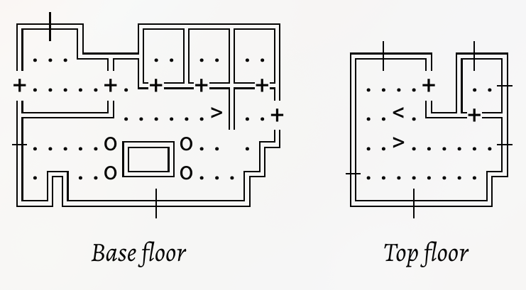

# Example Monsters

Here are a few examples of how to flesh out monsters in order to spice them up (the orc), turn them into vehicles (the snail) or weapons (the rat), introduce another genre (the talking head), make templates (the twisted), design bosses (the dragon) and create factions (the Whitecloaks). Although you can use all of them as they are, the point is rather to show ways of doing things.

## First Tribe Orc 

>DF: 5   HD: 4   MV: 25   LT: R
>
>*Great climber, stealthy, all-round resilient. Two strong abilities.* 

The First Tribe is an ancient mountain orc tribe, now all but extinct. Legend has it that their bite caused the orc equivalent of lycanthropy: bitten enemies would turn into orcs each new moon and eventually permanently, adding to the tribe numbers. The tribe having few remaining members puts the truth of this in doubt. 

First Tribe orcs are tough and experts at stealth and climbing. They fashion their armor from hardened leaves, wooden chips and enemy ears, resulting in a half weight equivalent of chainmail. They can eat humanoid meat and prefer to use shields and spears in battle. Their tribe symbol is a white new moon.

## Rock Snail

>DF: 4   HD: 10+15   MV: 30   LT: A(wild) or H(tame)
> 
>*Cold immunity, spit hot slime, tunnel through almost anything, shell can be excavated, can be trained.*

Rock snails are gargantuan snails, measuring up to 100 feet from tail to head and with huge stone shells. They are tamed young and trained not to use their shells, which are carefully excavated by stone masons to house up to two dozen travelers for weeks. Rock snails are the most reliable and safe way to travel glaciers and the snowy wilderness, as they are powerful enough to best white dragons and hostile orc tribes. They are practically immune to cold and can be trained to let their slime (which can also be spit) melt through ice and all but the hardest of rocks.

The base floor in this example shell is for cargo and passengers, while the top floor is for the crew. Doors are wooden with locks, windows are hatches, stairs and walls are stone. Use charisma for piloting and care, willpower for attacks.

## Spike Rat

>DF: 0   HD: 1 HP   MV: 10   LT: A
>
>*Terrifying scream, can explode spikes, poisonous.*

Spike rats are the peaceful hedgehogs of the Shadow Realm. When threatened, they curl up into balls, and if hit, their spikes explode, doing 1 hp damage—save negates, normal area of effect. The spikes are poisonous to a varying degree and to various effects, at the Referee’s discretion (see p. 57 for area attacks and p. 66 for poisons). Spike Rats make loud, bone-chilling screams as their spikes explode.

## Talking Head

>DF: 3   HD: 1+1   MV: 25/50   LT: R
>
>*Understand all languages, split gaze, shoot beams, tool-set, vulnerable to energy attacks. Can be played as a species class character.*

The Talking Head is magick construct made of metal, etched with runes, and with a conical shape that vaguely resembles a head. It hovers a foot above ground and has shining, yellow crystal eyes whose gaze can be directed as searchlights in simultaneous separate directions. It has a way of speaking that is hard to understand and sounds like the chirrups of a strange bird. Dirt and pieces of vegetation cover it. 

The Talking Head is not overly intelligent (as SV, which is 8) but understands and speaks any language at a basic level. It has a builtin tool-set that it can use to manipulate objects and mend itself, and it can fly short distances. It also has a built-in wand that can shoot magick rays of d6−1 damage every other round. The Talking Head can be played as a species class Deft or Clever Explorer character. It has no XP penalty due to its drawbacks in any humanoid society.

## The Twisted

This template can be applied to victims of a terrible curse. Most victims are disfigured to a degree, but some are changed on the inside, becoming indifferent, cunning, ingenious or suspicious. Ordinary people and animals fear, exile, enslave, persecute or even kill the twisted. It is a powerful social stigma that you could call the true nature of the curse. Elves, dwarves and halflings change the most. Their typical traits deteriorate so that they can barely be separated from each other or from twisted humans. Elves call it “the elven plague,” and it is rumored that some of them resort to vampirism to arrest the transformation. 

Twisted *characters* mark their stigma as a negative group on one attribute, counting it towards the maximum group total. For twisted elves, dwarves and halflings, the twisted group supplants the species group, putting it next to two attributes. In return, they get a supernatural ability equivalent of simple magick (p. 37). Each use raises CL by the amount that the ability has been previously used that day. Other twisted beings are altered at the Referee’s discretion, gaining weaknesses, strengths or both.

## Unzel (White Dragon Boss)

>DF: 4 & 0   HD: 6 & 3   MV: 30/40 & 5   LT: H
>
>*Boss, two stages (separated by '&' in that stat line), speaks Draconic only.*

Unzel has the ability to cover herself in a thick coat of magick ice when her HP goes below 10. When in the ice stage, she can only use breath attacks, loses her flight ability and moves slowly. Her breath attacks change from cones of cold into ice projectiles that hit a single target for d6+2 damage. Unzel’s ice stage must be killed (i.e. 3 HD worth of HP must be hacked away) before you can attack her normal body again. The ice can also be removed instantly with a lot of fire, like from lit lamp oil. Unzel will try to flee rather than fight once her ice form is killed. 

A Strong character may sample White Dragon saliva for her weapons, adding 3 points of cold damage. Optionally, if the Strong strikes the killing blow, the character can get a *sense gold* ability, sensing the direction and approximate amount of gold, in any form, within 300 ft.

## Whitecloak

>DF: 0/5/1   HD: 1   MV: 30/25/20   LT: R
>
>*1 strong ability (knights), 1 miracle (priests) or nothing (missionaries).*

The Whitecloaks is a religious order with political ambitions. The members believe that the curse (see “The Twisted,” p. 125) is a test of perseverance. Those who endure shall be rewarded by the God of Law in the afterlife. They organize correction camps for the twisted, who they consider morally corrupt, and sometimes show off “cured” individuals. But the camps are closed for outsiders, and many of the twisted never return.

The Whitecloaks are growing in numbers fast, recruiting mostly among the poor. They offer their services as peacekeepers, work to outlaw any but their own beliefs and want all magick users to be tested for the curse and for corruption.

There are three types of Whitecloaks: **Missionaries** are unarmed and unarmored. **Knights** are armed peace-keepers with chainmail, shields and swords. **Priests** are learned, sometimes wise and wear cloth armor and daggers. Knights and priests wear variants of the white cloak that has given the order its name.