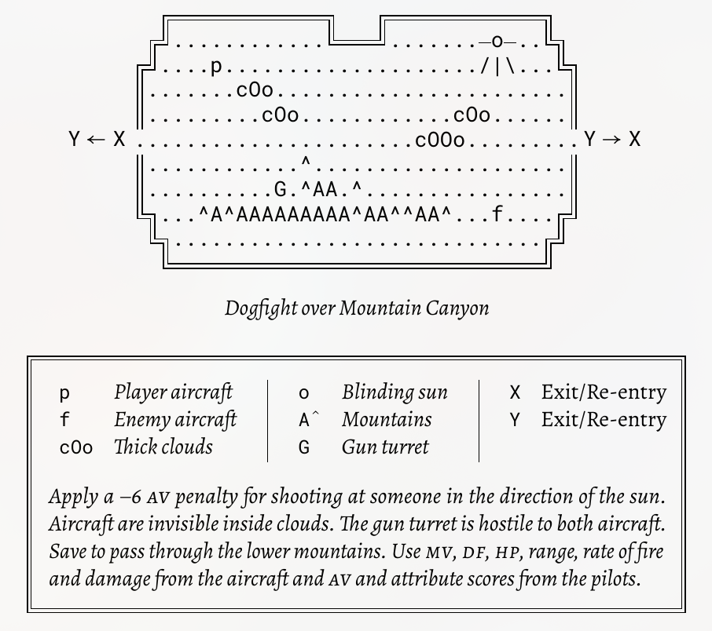
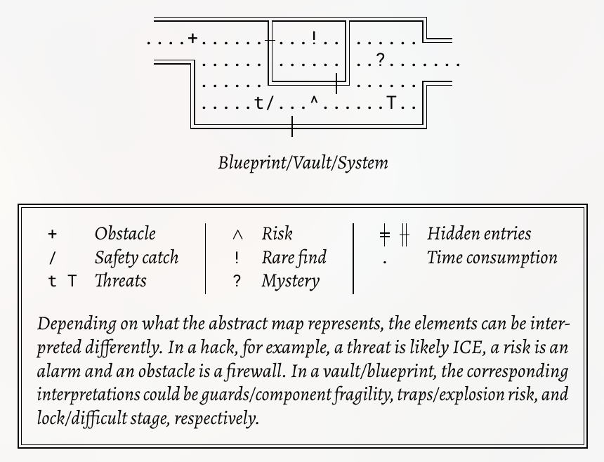

# Other Traditions

There is a lot of great material for games in other traditions, fully playable with a minimum of effort using *Whitehack* rules.

- For any system, use class/occupation/skill designations as Referee character *keywords* (p. 117) and treat the names of spells and special abilities as miracle wordings, just like you would for an original tradition module. 
- When a monster is similar in *Whitehack*, just re-skin it (i.e. use the stats but change the description). Find an equivalent armor in *Whitehack* and use its df. 
- Many percentile systems have 3d6 attribute scores in the *Whitehack* range. Use them as they are. 
- If not, divide any percentage with five, rounding down, to get a value that *Whitehack* can use. It isn’t a big deal if you happen to make a calculation error either. 
- Proportionally bring whatever is used for hp down to an approximate 1–20 range for humanoids, possibly more for larger monsters. Use the most apposite existing stat for sv. 
- Dice pool systems are often based on ranges of 1–8 dice, sometimes adding \[attribute\] + \[skill\] values to get them. Double such pools and treat the resulting number as a *Whitehack* attribute score. Use double rolls to take training or lack of training for (specialized) tasks into account. If the system lacks a HP value, use the most appropriate dice pool in the same way.

## Combat in Ships & Other Vehicles

Combat in vehicles such as ships or mechas can be very important parts of the game in some settings. The simplest way to handle this is to allow each vehicle to have harm points, movement, DF, SV and weaponry just like a character, and maybe also special attack or repair options. 

Each character is allowed control over one or several of these things. For example, one character may be steering, another may be shooting and a third may be in control of a secret weapon and the repair system. The player makes the executive decisions for her character’s part: Where does the vehicle go? Who does it attack? When does it use the secret weapon or start the repairs?

For some things, the characters’ stats can be used. For example, unless the description of the vehicle says otherwise, any character shooting can use her AV and any character steering can use one of her attributes (usually intelligence, agility or willpower). Various class abilities can also be applicable.

Aerial, underwater or space battles have three-dimensional movement and attack angles, but you only need two dimensions to resolve them. Use regular grid rules and design a classic, cavelike terrain representing the intricacies of positioning in a particular fight. Clouds, asteroids, debris, narrow ravines, a blinding sun etc., could all be presented concretely or abstractly this way. The dungeon shape provides line-of-sight functionality, and you could use exit and re-entry points to have the terrain fold into itself. This solution immediately gives crafts with different sizes, ranges, cloaking devices, movement rates etc. tactical advantages and disadvantages. Some of the advice on dungeon design (p. 102) applies here too.

## Building, Code-Breaking & Hacking

Building, code-breaking and hacking in a modern or future world can be handled as simple task rolls—in particular if the build, code or hack is simple and straight forward. But you have two additional options for cases where you want something more involved:

- Use an auction. Give the challenge a base value to represent its difficulty (cf. p. 52), and then use the auction rules. If the player wins, it is a success. If the player loses with a failed roll, it is a failed attempt. If the player loses through a fumbled roll or if the Referee makes the highest bid and rolls a success, apply a drawback—perhaps a ruined part, an alarm sounding or even ice doing damage to the hacker character.
- Use a dungeon map. Let the building process, the vault code lock or the cybersystem be represented by a more abstract version of a dungeon, where the engineer, thief or hacker has to make decisions about the best path, avoid traps and overcome resistances. The principles for good dungeon design presented in the next chapter apply (p. 102). This is much more involved, and you may need to cut between scenes to give players who aren’t involved something to do.

## Modern & Future Weapons

In modern and future settings, firearms or energy weapons are often more common than melee weapons.

- Set the base gun damage to d6, +1 if two handed/powerful. Stick to one attack per round, but automatic weapons get Burst for an extra +1 damage and Full Auto for an extra +2 (i.e. d6+3 maximum).
- Don’t track individual shots. Instead, make a d20 ammo roll after combat, vs. 10 if you didn’t burst and vs. 5 if you did. Failure means the current clip is used up. You can give small and large clip sizes double rolls. Full auto empties any clip immediately. Modern weapons take 1 round to reload.
- Add a ninth combat option for the Strong, called Spray. With a full auto weapon, you can make a regular area attack. Your attack roll counts against all involved dfs, dealing base damage to all that you hit. If you want to exclude someone in the area, a success must exceed that person’s df by at least 4, or you hit her anyway.
- Add a general Suppressive Fire attack option. You can cover up to three squares in suppressive fire. Anyone wanting to act in or pass those squares must roll in a contest with their willpower against the attack roll, and not lose. Failure simply means that you couldn’t act/go. Fumbling means that you got hit. Consider letting the Brave (p. 80) succeed on anything but a fumble.

## Scale

The default rules have scaling built in through HD and extreme scores (p. 49). But for genres with mechas, AI, exo-skeletons etc., you may note a Roman numeral next to **qualities** you want to be scaled—like “Submarine HP 17 (ii), d6 (iii)”—ranging from −ii (bug-like) to iv (godlike). Don’t note the default zero scale (’z’), and remember that listed monsters are already scaled through HD. 

On the same scale, use regular rules. For non-adjacent scales, don’t roll (“sorry, your halfling can’t grapple that mecha”). For *adjacent scales*, roll but modify **what can be achieved**. Maybe using an exo-skeleton, you can at least grapple away one attack per round from a mecha. In a mecha, you could not only grapple an exoed enemy, but also knuckle her exo so she can’t move. Weapons use the d10 vs. adjacent lower scale HP, but the d3 vs. adjacent higher scale HP.

## Corruption

Corruption in the form of madness, radiation, the influence of chaos, despair etc. is a key part of many settings. In *Whitehack*, this is handled through *corruption levels* (CL). 

Characters get one or more CLs when a game world condition is met. Getting trapped in high radiation, using forbidden magick or getting bit by a chaos creature could be such conditions. 

After CL has been raised, the player has the **option** of saving. Failing or fumbling the save means that the character’s cl has noticeable consequences—immediate or delayed as suits the setting and situation, at the Referee’s discretion. Radioactivity can cause a character to mutate, chaos or madness can give her some sort of phobia, despair can alter her behavior and make her more susceptible to evil influence, and so on. 

The gravity of the effect depends on the current cl when the save is failed, as per the Effects of Corruption table. CL is reset to zero after failing, but not after fumbling. If the save is successful, however, there is no effect, and CL is lowered by d6. 

The player also has the option *not* to save, provided CL isn’t too high. Then nothing happens and CL remains as it is. The player cannot save until cl has risen further. 

Corruption may also be advantageous. Some creatures, objects and places react to a stigma or high CL. Imagine a portal that only works for the sufficiently corrupt, or a goddess or demon sorcerer who will only trade knowledge with characters under enough chaotic influence.

### Effects of Corruption

| CL   | Effect                                                                                                                                                            |
| :--: | ----------------------------------------------------------------------------------------------------------------------------------------------------------------- |
| 1–3  | A minor effect in behavior or looks. It can be hidden from cursory examinations and goes away after a day or two.                                                 |
| 4–6  | A major effect that cannot be hidden, but goes away after a day or two.                                                                                           |
| 7–10 | A major effect that goes away after d6 weeks. The player is obliged to save at this level.                                                                        |
| 10+  | A major effect that is permanent. The player is obliged to save at this level. If CL exceeds 10+level, the character is lost to corruption. Roll a new character. |
{: .compact-table .range-table }

## Corrupting Magick

Some settings have the possibility of corrupting miracles. It can be a characteristic of certain magick types or effects, a specific method for dealing with the arcane, or both. 

Give the Wise the option to pay for miracles in CLs instead of hp in cases where the setting allows it, but make sure that this does not encourage using “safe” 1 CL miracles simply to always get early saves vs. corruption (thus maintaining a harmless corruption level). If the setting doesn’t do it already, you could restrict the option to randomized costs (i.e. at least d6), or make the magick types and effects in question involve some other risk. 

A world with corrupting magick is likely to have laws against it, perhaps with an inquisition and witch hunters persecuting corrupted miracle workers. There could be detection devices, or even monsters and other entities acting on corruption surges, seeking out the Wise.

## Customized Attributes & Implants

If you want, you can customize the character attribute array to better suit the setting, campaign, group or even individual player. This is best done for new characters, but with a bit of fiddling it can be done for existing ones, too (you have to decide what to do with bonuses the character has gotten from the default attribute array—either remove them, keep them as if they were custom, or a mix of both). 

To use custom attributes, remove any rule which tells you to roll for a specific attribute. The general rule is now to **always roll for the closest attribute for the task at hand**. Also remove automatic bonuses for anyone having an attribute score of 13+ or 16+. 

Then decide on a new set of attributes (5–7 ones is a solid choice), roll 3d6 in order and pick class and groups. Each player now gets two task rolls for one or two of the character’s attributes. On a success, the player picks a bonus from the list on the next page. On a crit, the bonus is doubled. (It is possible, but not recommended, to give a −1 penalty for fumbles.) The Referee may decide to allow positive double rolls for “aligned” characters, like rolling for strength with a Strong Strongman. Each time a character raises an attribute due to leveling, a new attempt can be made for that attribute, but you can only pick each bonus kind **once**.

### Custom Attribute Bonuses

| B   | Specification                | B   | Specification           |
| :-: | ---------------------------- | :-: | ----------------------- |
| +1  | AV, no doubling              | +1  | HP                      |
| +1  | Damage, no doubling (Strong) | +1  | Initiative              |
| +1  | SV, no doubling              | +2  | SV, specified save      |
| +1  | Inactive miracle (Wise)      | +1  | Inactive ability (Deft) |
| +1  | Reaction rolls               | +2  | Inventory Spaces        |
| +2  | Languages                    | +5  | MV, no doubling         |
{: .compact-table .even-columns-table .content-sized-table }

A future setting may use implants, which complicates attributes. The above bonuses can be used as minor implants, while major implants *replace* an attribute score altogether. For the medium case, you can use implant keywords that work like very limited groups (i.e. can yield double rolls).

Depending on the setting and the number of attributes you are using, you may want to regulate how many implants each attribute can have, and possibly also tie it to corruption. For example, if a character already has intelligence implants for “Alien Cultures” and “Imperial History¸” perhaps installing one for “Mathematics” as well comes at the cost of two *permanent* corruption levels?