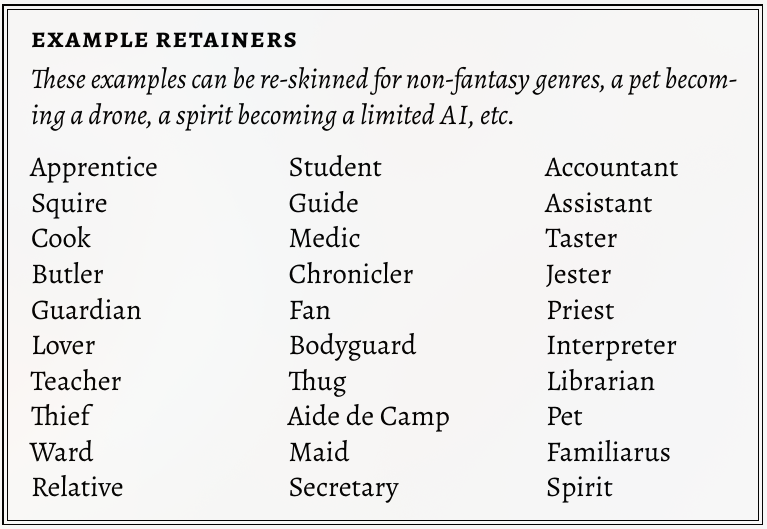

# The Fortunate

| Level | XP      | HD  | AV  | SV  | Slots | Groups | Raises |
| :---: | ------- | :-: | :-: | :-: | :---: | :----: | :----: |
| 1     | 0       | 1   | 10  | 6   | 1     | 2      | —      |
| 2     | 1,450   | 2   | 10  | 7   | 1     | 2      | 1      |
| 3     | 2,900   | 2+1 | 11  | 8   | 1     | 3      | 1      |
| 4     | 5,800   | 3   | 11  | 9   | 2     | 3      | 2      |
| 5     | 11,600  | 3+1 | 12  | 10  | 2     | 4      | 2      |
| 6     | 23,200  | 4   | 12  | 11  | 2     | 4      | 3      |
| 7     | 46,400  | 4+1 | 13  | 12  | 3     | 5      | 3      |
| 8     | 92,800  | 5   | 13  | 13  | 3     | 5      | 4      |
| 9     | 185,600 | 5+1 | 14  | 14  | 3     | 6      | 4      |
| 10    | 371,200 | 6   | 14  | 15  | 4     | 6      | 5      |
{: .compact-table .content-sized-table }

Fortunate characters are born with the advantages of nobility, fame, destiny, wealth, or a combination thereof. The Fortunate can for example be royal heirs, rich and influential merchants, star performers or religious icons. Once per game session, they may use their good fortune in a major way, like hiring a large ship, performing the will of a god, getting a personal audience with the ∗ queen or being hailed as a friend by a hostile tribe. [^1]

Fortunate characters have a defining standing that is noted in the Identity section of the character sheet and works like an occasional group booster. For example, a Fortunate Flower Monk with a “Reincarnated Master” standing might have unique tattoos, training and physical traits that boost the role of her groups in a number of situations. When the Referee thinks that the standing is relevant:

- Affiliated factions are considerably more helpful and their enemies more vengeful. Others may distance themselves or show interest. 
- The character’s species gives any applicable benefits regardless of attribute. 
- If standing and vocation align for a task, and the vocation is marked next to the applicable attribute, the character gets a +6 bonus.

As the only class, the Fortunate are also allowed to have retainers that can grow in strength, like a chambermaid, a cook, an apprentice or a squire. The Fortunate start the game with one retainer and gain slots for additional ones. 

A fortunate retainer has HD, DF, MV and keywords as per the monster rules (next chapter). DF and AV (HD+10) may be reconsidered if her equipment changes, and hd increases at the Fortunate’s even levels. The first retainer, if she lives, will be HD 6—a respectable aid indeed—by the time the master is level 10. 

At the Referee’s discretion, retainers do their work within the confines of a written or otherwise established contract, but also have ideas, feelings and attitudes (devout, rebellious, loving etc.) concerning their position and the fortunate standing. They are Referee characters, but the player may switch into the retainer role for part of an adventure: “As D’bra lies unconscious from that illsprout attack, I’m going to play her cook instead.” 

The Fortunate may use any weapon or armor without penalty. They have +4 to charisma when checking retainer morale, +2 in reaction rolls and +6 in any reputation roll. They also get a single signature object. At the Referee’s discretion it may be of special material, superior quality or even magick, but the only obligatory special ability is **plot immunity**: it can never be lost, destroyed or be made irretrievable by the Referee unless the player wishes it to happen.

### Example Retainers

[^1]: The Fortunate may however not use their good fortune class power to purchase experience or fund xp for others.