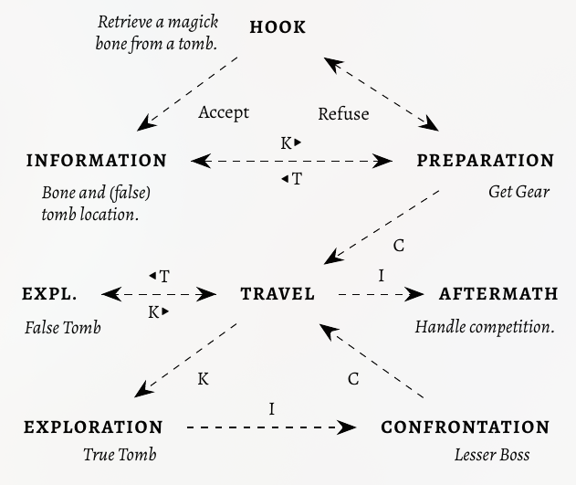
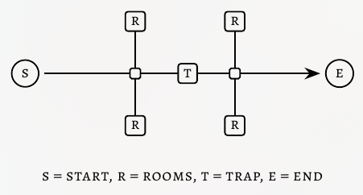
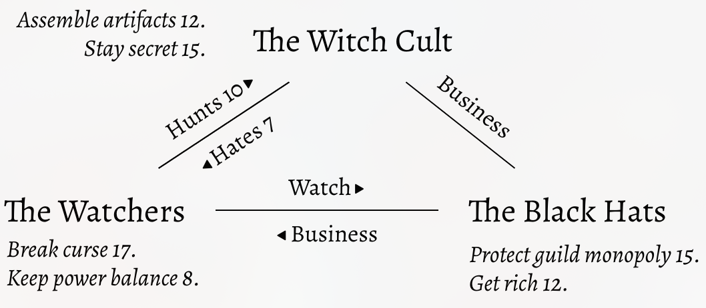

# Adventures

There are many ways to write adventures. Although neither may exist in “pure” form, you may find it useful to distinguish between three basic ideas: 

- **The predefined story.** This format looks like a finished story. It uses a limited set of adventure phases and can play out differently from how it is written. 
- **The dungeon map.** This format consists of a map with keyed rooms and a nearby location where the characters can get provisions and medical aid. 
- **The mind map.** This format lays out the Referee characters, factions and agendas, with some trigger events. 

Each adventure format has advantages. The predefined story is evocative to read or write. The dungeon map is easy to use. A mind map with agendas is essential for a city adventure or sandbox campaign. Some techniques are described on the following pages, but there is no reason to be dogmatic. Mix them and find your own style!

## Use & Process

Another helpful distinction is the one between *use* and *process*. It is common to value material that you can use directly at the table over a story-like structure, under the assumption that the latter leads to rail-roading. But reading or writing are processes which prepare you for improvisation, in *particular* if it is a single track story with a predefined end. A readerly mind is used to the evocative narrative and may explore alternative character actions and game world reactions that aren’t in the text. 

You can enforce this as a method. When you come to an adventure crossroads, stop to think: What will happen next? What if the characters do something else? What if someone resets that trap? Compare it to a whodunit crime novel, where your mind is busy figuring out who the murderer is before the end. Just remember not to get too attached to your own answers. What you are experiencing is the potential of something that has yet to be created. You never get to dictate player choices.

## Building with RPG Story Phases

In *Whitehack*, you can use phases to build your adventures and to better time play. There are (at least) seven kinds that are particularly common:

- **Prelude**, or “**Hook**,” as in how the characters get involved and accept (or reject) a mission. Unless this phase contains a true choice, you can usually skip it, jump right into the action and let the players explain why the characters are there. 
- **Preparation**, as in getting equipment, doing some preparatory research, gathering gossip, doing recon trips, arranging transportation, etc. 
- **Travel**, as in journeying to the main location of the adventure, hexcrawling, visiting a wayside shrine or resting at an inn and meeting fellow travelers. 
- **Exploration**, as in exploring a labyrinth or dangerous place, dungeon crawling, breaking and entering, storming a castle, investigating a crime scene, etc. 
- **Confrontation**, as in a *major* one, usually with a boss enemy or monster at the end of a larger battle. 
- **Aftermath**, as in how to get home, dealing with the repercussions of what has happened, recuperating, spending loot and getting training. 
- **Socializing**, as in a *recurring* or *parallel* phase for resting, socializing and character development (as in developing relations, talking about the past, etc.).

The phases don’t have to come in the above order, or get equal focus. You can rearrange or exclude some phases to get different kinds of adventure, or to adapt the game to suit what your particular groups is most interested in.

For instance, the mystery adventure is mostly about gathering information (i.e. preparation and exploration), while the dungeon crawl is about exploration and confrontation. City adventures often end up being about intrigues, factions and chain reactions to character actions. This puts most of them in a perpetual socializing phase. The aftermath adventure begins after the lord of the dungeon is dead—now you have to get home alive and figure out how to get rid of the cursed loot!

## Phases, Bases & Paces

Phases make pacing easier. For example, you could give *base interventions* (p. 90) a double costs after the first time they are used in a phase, preventing a base to be used several times in quick succession. You could further enhance this by stating that any base re-writes must be done in the preparation or aftermath phases. 

At conventions or whenever time is limited, you can set realtime limits for each phase. Any remaining time when a phase is finished can be added to the next, and conversely, any extra time required to finish one cane be deducted from the next. If things drag on, you may as the Referee take over and quickly narrate the end of a less crucial phase, to get enough time for a more crucial one.

## Mapping Phases

Finally, it can be useful to create a simple phase map before diving into the actual writing. Mark the phases you want on a piece of paper and **link** them based on what the characters can or must do to move between them. Consider using combat (C), task (T), knowledge (K), social (S) and item (I) links, as shown in the example below:

## Constructing Dungeons

Using the roguelike map elements (next page, cf. p. 22), draw an entrance, a corridor and a few rooms, then key the rooms and fill them with monsters, traps and a treasure. Call this “The Tomb of Tunka Jinn” and give the characters a mission to go there. Done! Just change the title and the backstory to suit your needs. This is simple, but there are also a few tricks to good dungeon design: 

- Your dungeon need not be huge, but should have **several entry points**, at least one of which is **hidden**. If the dungeon has **levels** (a good idea), put an entrance at a lower level. This allows for tactical choices and rewards characters who research and examine the dungeon before going in. Perhaps the above tomb connects to an older cave system that the locals know about? 
- Draw **several ways to get about** in your dungeon, not just one corridor to each room and one passage to each level. Let your corridors **connect** and run in **circles**, and let there be several **stairs** and **chutes** leading down and up, some of them **by-passing a level** or two. Let there be **secret passageways** for the characters to find. Put **chasms**, **crumbling bridges**, **elevators**, **slopes** and **elevation shifts** in the dungeon, but also some **landmarks**, so that the players don’t get too confused. Apply a tactical perspective: Where can the characters rest in relative **safety**? What points are defensible if they need to retreat? 
- A good dungeon has its own **ecology**. Whatever lives there normally needs to sleep, eat and see to other basic needs. Larger dungeons usually have **factions** that are at odds with one another, and clever players let their characters take advantage of such situations. Remember that not everything in a dungeon needs to be killed, and that the “dungeon mode” of the game benefits from being interspaced with a “city mode”—otherwise it doesn’t stand out and stops being exciting. 
- **Traps** can be simple, like “the stair has a d6 damage arrow trap, save negates,” or be more complex with exact descriptions. As previously suggested (p. 94), a good Referee finds ways to subtly indicate that traps may be ahead. You should also think about traps in relation to the dungeon residents and competing adventurer parties: some traps are likely **inactive or sprung** already, and some traps may be **reset**.
- A good idea when designing your dungeon is to **draw its structure** before putting anything else in there. If the structure is poor, resembling a straight line like in the example below, it is likely not much fun to play.

### Boring Dungeon Structure

### Sample Roguelike Map Elements

| E   | Dungeon    | E   | Creature   | E   | Overland  |
| :-: | ---------- | :-: | ---------- | :-: | --------- |
| !   | Potion     | C   | Cockatrice | ’   | Desert    |
| )   | Weapon     | D   | Demon      | *   | Dungeon   |
| *   | Rock       | G   | Golem      | .   | Route     |
| .   | Floor      | S   | Spider     | =   | Glacier   |
| <   | Upstairs   | V   | Vampire    | R   | Ruins     |
| >   | Downstairs | W   | Wyrm       | &   | Forest    |
| ?   | Scroll     | a   | Amphibian  | ^   | Mountains |
| #   | Wall       | b   | Bat        | o   | Tower     |
| $   | Crowns     | c   | Centaur    | “   | Plains    |
| &   | Statue     | g   | Goblin     |     |           |
| ^   | Trap       | h   | Hobgoblin  |     |           |
| _   | Altar      | m   | Monkey     |     |           |
| ~   | Water      | o   | Orc        |     |           |
| ]   | Armor      | r   | Robot      |     |           |
| ¡   | Detector   | s   | Swarm      |     |           |
| °   | Ring       | t   | Troll      |     |           |
| ł   | Teleporter | v   | Vulture    |     |           |
| ‘   | Jewelry    |     |            |     |           |
| “   | Tome       |     |            |     |           |
{: .compact-table .even-columns-table }

## Mind Maps, Agendas & Events

Handling city intrigue and other adventure types that hinge on multiple party agendas is easy if you use a mind map, like the one above. Make a node each for the agendas of all major characters and organizations that play a part in your plot. As you will see, the Referee stat blocks are really short in Whitehack, so you can put such information, as well as notes on reputation (p. 112), in each node as well.

Connect the nodes and note the type of connection. For example, one node may be “employed by” another node, who in turn is “afraid of” a third node. Nodes may be connected differently in opposite directions, like when one node thinks of another as a friend, while she is in fact an enemy. The numbers in the example mind map are for randomized reactions, as explained on the following page. 

Once you are done with the mind map, make a list of events that you think both the player characters and your factions and individuals could react to. Try to find events that require response without constricting the characters to a single acceptable choice. For example, if the characters are knights in need of crowns for some higher goal, but also have a strict chivalric code, a huge reward for a dubious or villainous deed will give the players an interesting moral choice, since there are others who are sure to collect the reward if the characters don’t. 

Now you are done. All you need to do is to put things in motion using one of your events. As the party responds, it will trigger one or several nodes, and their actions will in turn affect other nodes, urging the party to respond again. If things slow down, use your events.

## Randomized Events & Reactions

If you want, you can randomize what happens in the game world, both as a consequence of the characters’ actions and as a consequence of the events that you bring into the world. Doing this takes some of the onus of decision-making off your back, and it can create a very strong sense of the game world having a life of its own. 

Mark agendas and relations with numbers similar to attribute scores, in order to indicate their importance for the faction or individual. For example, if the Witch Cult has “Stay secret 15”, it indicates that staying secret is very important to them (average would be 11). Then mark your events too, but with modifications to indicate their severeness. “Black Hat thief identifies a cultist, −2” could be an example of a less than medium event. Now, if you want to get an indication as to what happens, make a modified d20 roll for the Witch Cult’s agenda to stay secret, that is 15 − 2 = 13.

- A success means that they react, and you can use the roll quality to indicate how strongly. 
- A crit means that they have a huge but not disproportionate reaction. 
- Failure means that they don’t react. 
- A fumble means that they misunderstand the situation and react disproportionately.

If you want, you can turn the reaction into an event, assessing its severity and giving it a modification. Now other factions can react too, and you get a chain reaction. Naturally, you can assess what the player characters do too, and use it in the above manner.

## Self-Playing Characters

An advanced use of the randomized events and reactions mechanism is for players to act as Referees for their own characters in a part of an adventure. They can mark beliefs and convictions just as with Referee characters, and then either assess events themselves, rolling to see how their characters react, or ask the Referee and co-players to help out. This can be useful when you don’t want to or can’t make a choice yourself, or in conjunction with phases to quickly fast-forward to a new phase.